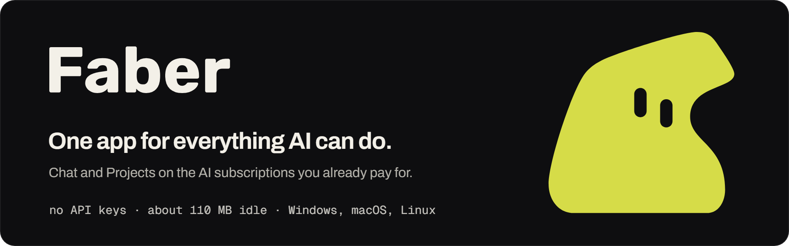
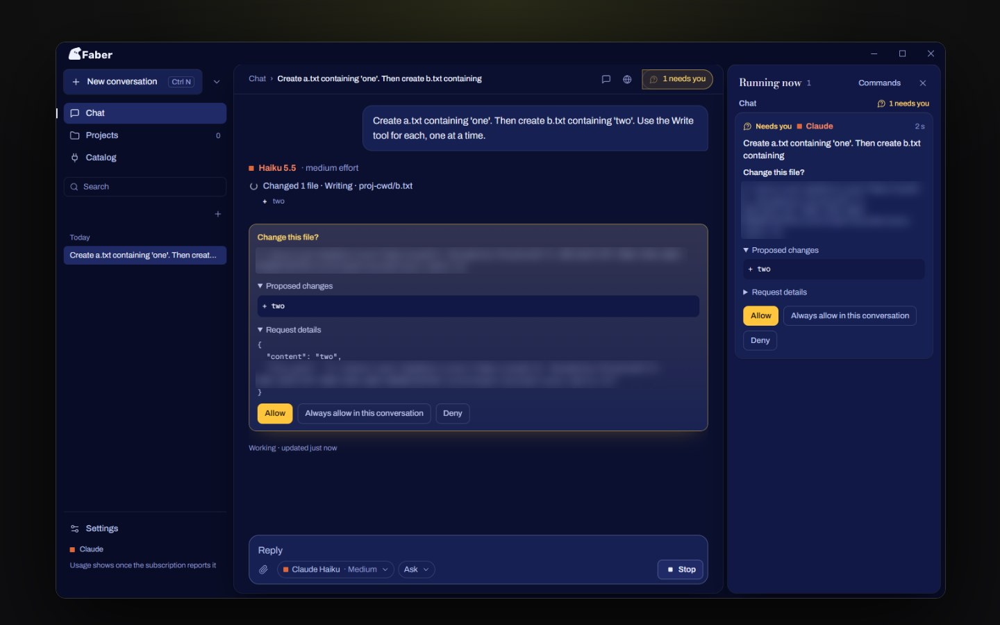
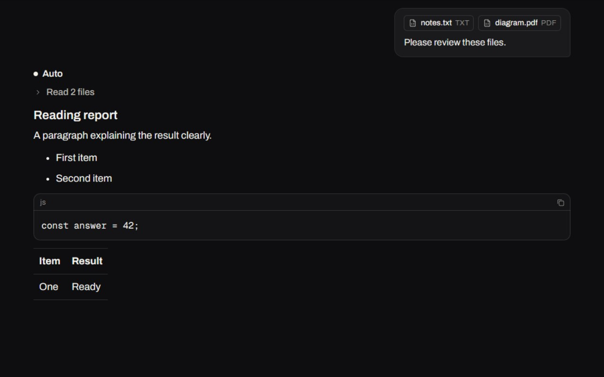
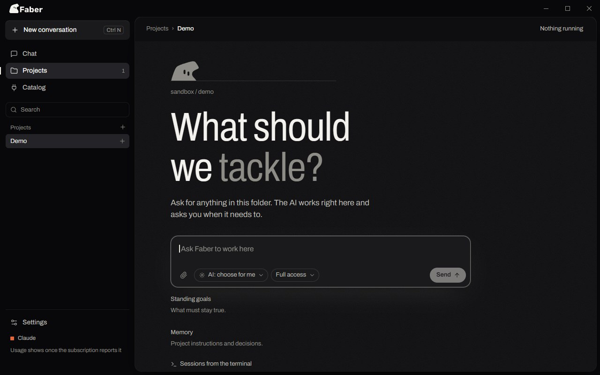
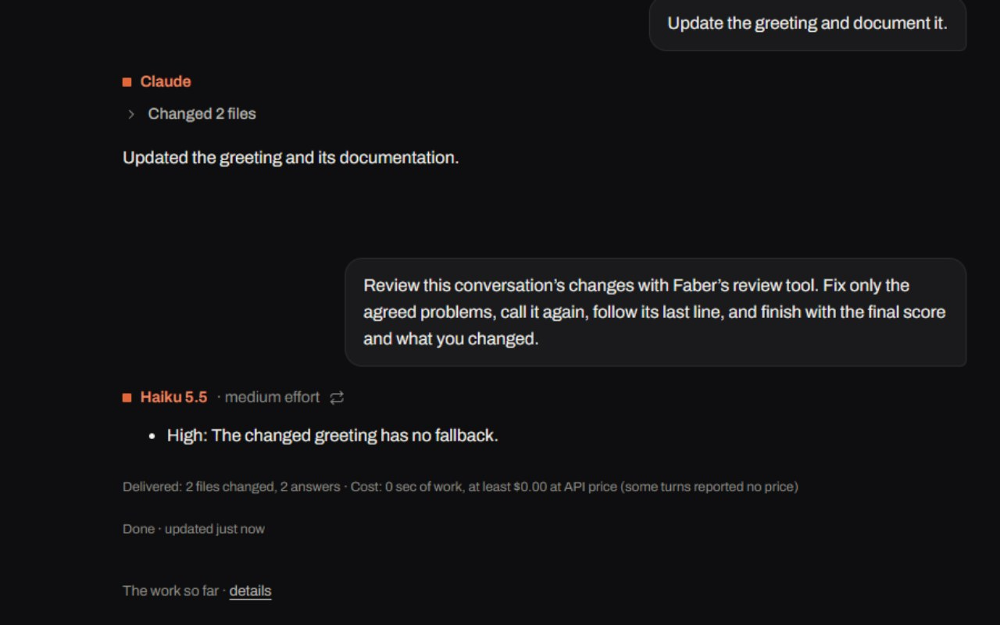
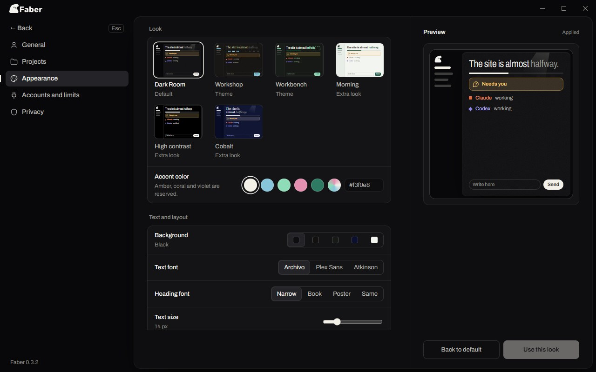
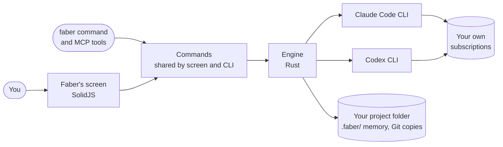

<div align="center">



<h3>

[Download](#install) · [What it does](#what-works-today) · [How it works](#how-it-works) · [Roadmap](docs/product/README.md) · [Discussions](https://github.com/startRED/faber/discussions) · [Contributing](CONTRIBUTING.md)

</h3>

[](https://github.com/startRED/faber/releases/latest)
[](https://github.com/startRED/faber/actions/workflows/ci.yml)
[](LICENSE)

<br />



</div>

<br />

Faber is a desktop app with a **Chat** and a **Projects** area that runs the official Claude Code and Codex
command-line tools on the subscriptions you already pay for. Start a conversation, let the AI work in your folder and
stay in charge: it can ask before it changes things, shows what it did and keeps your project's memory in plain files.

It aims to do anything AI can do, at commercial quality, so you never need another AI app. If you use AI every day it
feels familiar; if you never have, you learn it by using it. It runs on Windows, macOS and Linux, with Windows first.

## What you get

- **Your subscriptions, the unmodified CLIs.** Faber works with Claude Code only, Codex only, or both.
  You sign in through each tool's own flow; Faber never
  reads, copies or stores your credentials.
- **Light by design.** Rust engine and SolidJS screen. Faber measures about 110 MB idle, and its end-to-end test fails
  if it goes above 400 MB.
- **Nothing third-party is bundled.** No third-party tools, skills, models or MCP servers ship in the app or the
  repository. The Catalog downloads vetted items from their original source and shows the license first.
- **Project memory in plain files.** Decisions, taste, plans and recipes live in a `.faber/` folder inside your project,
  so your work outlives the app.
- **Telemetry is off by default.**

<table>
  <tr>
    <td align="center" width="33%"><h3>~110 MB</h3>idle, with no CLI running</td>
    <td align="center" width="33%"><h3>No</h3>API keys needed</td>
    <td align="center" width="33%"><h3>5</h3>hand-written languages</td>
  </tr>
</table>

## A look inside

Real Faber screens, photographed by its own screen tests.

<table>
  <tr>
    <td width="50%" valign="top">
      
      <p><b>Chat, with Auto.</b> Pick a model and effort yourself, or let Auto choose for each message and say which
      model answered and why. Attach files; answers come formatted.</p>
    </td>
    <td width="50%" valign="top">
      
      <p><b>Projects work in your folder.</b> Many conversations per folder, separate Git copies when you want them, standing
      goals, checks and memory.</p>
    </td>
  </tr>
  <tr>
    <td width="50%" valign="top">
      
      <p><b>Review before you keep it.</b> Ask for a review of a conversation's changes, by the other AI when both are connected.
      Findings come back in the conversation.</p>
    </td>
    <td width="50%" valign="top">
      
      <p><b>Make it yours.</b> Pick a look, then your own accent, fonts, density and motion, with a live preview.</p>
    </td>
  </tr>
</table>


<p align="center"><sub>Four of the six looks: three themes and three presets, with your own accent, fonts, density and motion.</sub></p>

## Install

Open [the latest version](https://github.com/startRED/faber/releases/latest), find **Assets** at the bottom (click it if
it is folded) and download the one file for your computer. `<version>` is the number shown on that page.

| Computer | File |
| :--- | :--- |
| Windows | `Faber_<version>_x64-setup.exe` |
| Mac with Apple silicon (M1 and later; Apple menu > About This Mac says "Chip") | `Faber-<version>-arm64.dmg` |
| Mac with an Intel processor (About This Mac says "Processor") | `Faber-<version>.dmg` |
| Linux | `Faber_<version>_x86_64.AppImage`, or `Faber_<version>_amd64.deb` on Debian and Ubuntu |

Skip the other files (`.zip`, `.app.tar.gz`, `latest.json`, `SHA256SUMS.txt` and the source code): Faber uses them
to update itself.

- **Windows:** double-click the `.exe` and follow the installer. Faber is not code-signed yet, so Windows may show
  "Windows protected your PC": click **More info**, then **Run anyway**.
- **Mac:** open the `.dmg`, drag Faber into **Applications** and open it from there. Faber is not notarized by Apple
  yet, so the Mac may say it cannot check the app: close that message, open **System Settings > Privacy & Security**,
  click **Open Anyway** next to Faber, confirm, and open Faber again.
- **First start:** Faber asks you to connect your subscriptions. You need one plan: Claude Pro or Max, or ChatGPT
  Plus or Pro for Codex. If the tool is missing, **Install** downloads the official program and checks the file is the
  original (or use its official install page); then **Sign in** opens that tool's own sign-in.
- After that Faber checks for updates by itself.
- Every release carries build provenance. To check a download, run
  `gh attestation verify <file> --repo startRED/faber`.

## What works today

- **Chat**: many conversations with an optional working folder and a permission mode that decides whether files may
  change. Pick a model and effort, or **Auto**, which picks per message and shows which model answered and why.
  Branching, queueing or steering a message while the model works, search, groups with shared instructions, temporary
  chats, and visual answers (inline interactive pieces, HTML, SVG and Mermaid previews).
- **Projects**: open a folder and keep many conversations in it. Separate Git copies (worktrees), project memory in
  `.faber/`, confirmed project checks and standing goals, helpers, reviews by another model, Keep going runs, pull
  request following, a changes viewer and Faber's own browser pane.
- **Catalog**: browse, install, switch on and audit pinned community skills and tool servers from their original
  sources, without editing your CLI configuration folders.
- **Command line and MCP**: the `faber` command controls conversations over a private, user-only local channel, and
  Faber's commands are available to agents as tools.
- **Desktop**: tray icon with a status badge, five hand-written languages (English, Brazilian Portuguese, Spanish,
  French, German), six looks (three themes and three presets with your own accent, fonts, density and motion) and
  signed self-updates.

The [illustrated product demo](demos/faber/README.md) shows a project conversation from request to result. It is an
illustration that runs no AI: `npm run demo` opens it locally.

## How it works



Faber starts the official command-line tools unmodified, never through a shell, and reads what they report. You sign in
through each tool's own flow. Conversations and projects are JSON files on your computer, and a project's memory lives
in its own `.faber/` folder. How the pieces fit, with the memory and processor budgets, is in
[architecture](docs/product/architecture.md).

## On the roadmap

Version 1.0 is out and work moves fast. The [roadmap](docs/product/README.md) lists the next phases: the move to an Electron shell,
Gemini through Antigravity for Projects, a live CLI compatibility manifest, then image and design work, a phone remote
with routines, video, and driving desktop apps. See what is in progress and what just landed on the
[board](https://github.com/startRED/faber/blob/board/BOARD.md).

## Repository layout

| Folder | What it holds |
| :--- | :--- |
| `engine/` | Rust: drives the CLIs, stores conversations and projects as JSON files; no windows |
| `host/` | The one command table every front end calls (window, command line, tests) |
| `sidecar/` | The host as a child process of the Electron shell, over newline-delimited JSON |
| `cli/` | The `faber` command line |
| `channel/` | The private local channel the command line uses to reach the running app |
| `src-tauri/` | The Tauri shell that ships today |
| `electron/` | The Electron shell that will replace it |
| `ui/` | The screen: SolidJS and TypeScript, with every text in `ui/locales/` |
| `update/` | The self-updater |
| `winproc/` | The small amount of unsafe Windows process code |
| `installer/` | Electron installer packaging |
| `testkit/` | Faber's own Rust test runner and screen checks (`cargo t`) |
| `tests/` | Screen checks written in TypeScript |
| `scripts/` | Repository tooling: proofs, releases, docs checks |
| `bench/` | The benchmark against plain CLIs |
| `docs/` | Living documentation, indexed in [docs/README.md](docs/README.md) |
| `demos/` | The illustrated product demo |

### Working on Faber with an AI agent

The repository is written to be read by coding agents as well as people. Point yours at these, in this order:

| File | What it gives the agent |
| :--- | :--- |
| [AGENTS.md](AGENTS.md) | The rules every contributor follows, the stack and the proof commands (`CLAUDE.md` imports it) |
| [docs/README.md](docs/README.md) | Which living page answers which question, so the agent reads one page instead of a folder |
| [docs/product-map.md](docs/product-map.md) | What Faber has today, part by part, so new work extends it instead of adding a second way |
| [docs/decisions.md](docs/decisions.md) | The owner's decisions, numbered; search it for a word rather than reading it whole |

## Build from source

You need Node 24 or newer, a stable Rust toolchain and the [Tauri prerequisites](https://tauri.app/start/prerequisites/)
for your system. On Windows that means the C++ build tools and WebView2. On Linux it means:

```bash
sudo apt-get install -y libwebkit2gtk-4.1-dev libayatana-appindicator3-dev librsvg2-dev libxdo-dev libssl-dev patchelf
```

Then:

```bash
npm ci
npm run dev
```

`npm run dev` opens the Tauri shell from source with live reload. Before a change goes in, all of these exit 0:

```bash
npm run lint && npm run typecheck && npm run docs && npm run build && cargo fmt --all --check && npm run test:scripts && node scripts/cargo.mjs t --claims
```

`node scripts/cargo.mjs t` runs only the tests that depend on the files you changed; `node scripts/cargo.mjs t --all`
runs the full suite, including the hidden-window screen tests on Windows. Run it when the screen or the shell changes.

## Contributing

Bug reports, fixes, documentation and native-speaker translations are welcome. Start with
[CONTRIBUTING.md](CONTRIBUTING.md), and see the [Code of Conduct](CODE_OF_CONDUCT.md). Report security problems
privately as described in [SECURITY.md](SECURITY.md). Questions and ideas go to
[Discussions](https://github.com/startRED/faber/discussions).

## Star history

If Faber is useful to you, a star helps other people find it.

<p align="center"><a href="https://www.star-history.com/#startRED/faber&Date">
  <picture>
    <source media="(prefers-color-scheme: dark)" srcset="https://api.star-history.com/svg?repos=startRED/faber&type=Date&theme=dark" />
    <source media="(prefers-color-scheme: light)" srcset="https://api.star-history.com/svg?repos=startRED/faber&type=Date" />
    
  </picture>
</a></p>

## License

Faber is source-available, not open source. It is under the [Functional Source License 1.1, Apache 2.0 Future License](LICENSE)
(`FSL-1.1-ALv2`): anyone may use, modify and share it for any purpose except a Competing Use, as `LICENSE` defines it,
and each version becomes available under Apache 2.0 two years after its release. See [NOTICE](NOTICE) and
[license and distribution](docs/product/distribution.md). What you create with Faber belongs to you.
