<div align="center">


<h3>

[Download](#install) · [Faber or something else?](#faber-or-something-else) · [Why Faber](#why-faber) · [The numbers](#the-numbers-including-the-ones-we-lose) · [FAQ](#faq) · [Docs](docs/README.md)

</h3>

[](https://github.com/startRED/faber/releases/latest)
[](https://github.com/startRED/faber/actions/workflows/ci.yml)
[](LICENSE)
[](https://github.com/startRED/faber/releases)

<br />

<h2>Claude Code, Codex and Antigravity in one desktop app,<br />on the plans you already pay for.</h2>

</div>

**Faber is a free, open-source desktop app for people who build things with AI, programmers or not.** It runs the coding tools
from Anthropic, OpenAI and Google (Claude Code, Codex and Antigravity) on the Claude, ChatGPT or Google AI plan you
already pay for. No API keys, no second bill, no Faber account.

Chat is for asking, writing and thinking something through. Projects is where the AI works in a folder on your
computer. Faber then does the work those tools leave to you. It picks the model for each conversation and says why.
It paces your weekly quota. In Projects it gives parts of a big job to helpers that report back in a paragraph
instead of rereading your chat. And when the AI says "done", it checks that word against what really ran.

<div align="center">

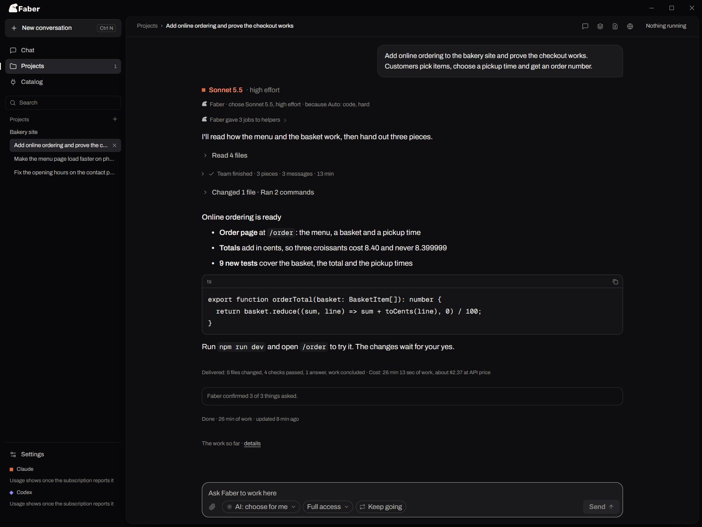

<br />

**[Download for Windows, macOS or Linux](#install)** · free and open source (MIT) · one plan from any of the three makers is enough

</div>

<table>
  <tr>
    <td align="center" width="25%"><h3>3</h3>AI tools in one window</td>
    <td align="center" width="25%"><h3>0</h3>API keys, extra bills or new accounts</td>
    <td align="center" width="25%"><h3>2</h3>reviewers that did not write the code</td>
    <td align="center" width="25%"><h3>~110 MB</h3>of memory while no AI tool is running</td>
  </tr>
</table>

## What you get

- **["Done" has to be proven.](#1-done-has-to-be-proven)** In Projects, Faber matches the AI's "done" against the
  commands that really ran and tells you, in plain words, what it could and could not confirm.
- **[You see the work.](#2-you-see-the-work-and-you-can-take-it-back)** Faber's own browser (on Windows today),
  before and after pictures of your app, every changed file, and a way back to before a message of yours.
- **[Auto picks the model and says why.](#3-your-quota-is-treated-like-money)** A model for each conversation and an
  effort for each message, priced by the quota you have left this week.
- **[The project remembers.](#4-the-project-remembers-and-keeps-its-promises)** Decisions in plain files you own,
  "never touch" rules that Claude Code's file tools are refused on, and goals Faber rechecks every six hours once you
  switch them on.
- **[A team that does not reread itself.](#5-a-team-that-does-not-reread-itself)** Helpers start from a brief of
  their own and answer with a short report. No helper is handed anybody else's transcript.
- **[Light on your computer.](#6-light-on-your-computer-and-yours)** About 110 MB with no AI tool running, usage
  reporting off by default, and no third-party tool, skill or model bundled.

One plan is enough to start: Claude Pro or Max, ChatGPT Plus or Pro, or Google AI Pro or Ultra.
**[Install Faber](#install).**

## Faber or something else?

**Pick Faber when** you pay for one or more of these plans and want more out of them than each tool gives you alone:

- proof instead of a summary when the AI says it finished;
- Claude Code and Codex working together: one builds, the other reviews, and the conversation goes on with the
  second when the first runs out of quota;
- the model chosen for you with the reason shown, and answers in everyday words.

**Pick something else when** it fits you better. As of November 2026, from each project's own pages:

| If you want | Pick | Because |
| :--- | :--- | :--- |
| Many different AI tools (Cursor, OpenCode and more), phone and web apps, remote machines, voice dictation, scheduled tasks | [T3 Code](https://github.com/pingdotgg/t3code) | It reaches far more AI tools and devices than Faber does |
| An always-on personal agent you reach from Telegram, Discord or Slack, on any model, with schedules | [Hermes Agent](https://github.com/NousResearch/hermes-agent) | It is its own agent with its own learning loop, not a front end for the makers' tools |
| Any provider, local models or free models, with API keys or a ChatGPT or Copilot plan | [OpenCode](https://opencode.ai) | It is its own open-source agent, on desktop, terminal and phone, and supports 200+ providers |
| Many parallel agents on a Mac | [Conductor](https://www.conductor.build) | It is built around one workspace per task, on macOS |
| One maker only, with live voice conversation, cloud sessions or control of your other desktop apps | That maker's own desktop app | They have those today and [Faber does not](#what-faber-does-not-do-yet) |
| One tool in a terminal, and you like it that way | The terminal | You may not need Faber |

Those projects give you more tools and more places to run them. Faber goes the other way: three tools, and more of
the work around them done for you. Choosing the model, pacing the quota, proving "done" and getting a second maker to
review are things you would otherwise do by hand in every conversation.

## Why Faber

The makers publish how to get the most out of their tools: which model for which job, when a team helps, what makes
a long conversation expensive, why agents say "done" too early. Few people have time to apply all of it by hand in
every conversation. Faber turns that guidance into behaviour and, where it can, into limits in code that a long
session cannot forget. [Where each idea comes from](#where-the-ideas-come-from) is listed below.

### 1. "Done" has to be proven

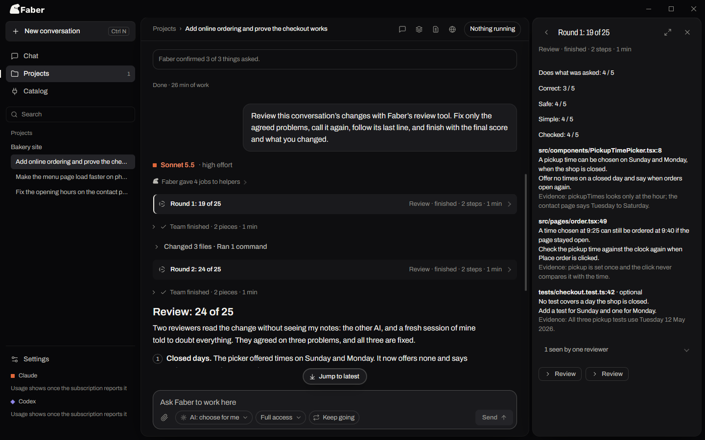

A common complaint about coding agents is that they say "done" without doing the work. In Projects, after the AI
changes code, Faber checks that word itself. It answers with code first: matching a "done" against what really ran
costs no model call.

- **A closing box in Faber's own words.** "Faber confirmed 3 of 4 things asked", "Not confirmed: ...", "The last
  check after the edits failed". It also flags a test that was turned off or deleted, code left as a placeholder, and
  files changed outside the plan. An unproven "done" is sent back twice, then shown as "Done, but not confirmed".
- **Review by reviewers that did not write the code.** Two fresh sessions; the first is the other maker's AI when
  Claude Code and Codex are both connected and it has quota left. They score the change out of 25 on five plain
  lines. A problem goes back to be fixed only with evidence and, when both reviewers answered, only if both found it.
  It stops at 21 of 25 or three rounds.
- **A loop gets noticed.** The same step six times, the same check failing three times, or ten quiet minutes (thirty
  while a command runs), and Faber says so, with Stop beside it. It stops a reply by itself only after 15 silent
  minutes.

<details>
<summary>More: your project's checks, and one question before the work</summary>

<br />

- **Your project's checks.** You say which commands prove the project works. In Full access the AI runs them through
  Faber and gets back a short failure list instead of the whole log, with file and line for Rust, TypeScript and
  oxlint (other tools: the last 20 lines). On the quick pass, a check that already passed on exactly the same content
  is not run again; the full pass before delivery runs them all.
- **One question before the work starts.** On a project's first short request with Auto, only when a wrong guess
  would throw most of the work away (or two or three looks to pick from when you name none).

</details>

### 2. You see the work, and you can take it back

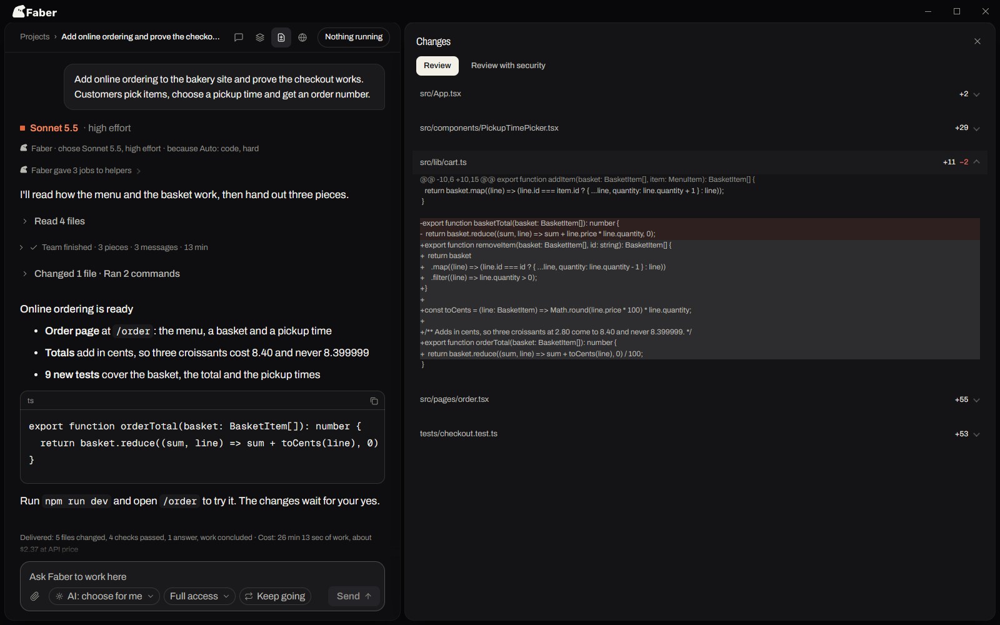

- **Faber's own browser**, on Windows today. A pane with tabs beside the conversation. In Projects with Full access
  (the default) the AI can read, click and type in it; sign-ins, captchas and payments stay "Your turn".
- **Before and after pictures.** On Windows, a finished project answer shows each known local page of your app before
  and after, up to three pages.
- **What changed, listed.** Changed files under each answer, a Changes pane in Projects that shows the exact lines,
  and a work log in plain words, with the AI asked to answer without commit hashes or jargon.
- **Go back.** Return to before a message of yours with its saved files restored (kept 30 days, up to 1 GB), and Redo
  while it lasts.

<details>
<summary>More: Run my app, answers you can use, permission modes</summary>

<br />

- **Run my app** (npm projects, Windows today) opens it beside the chat; the AI can check it at several screen sizes
  and flags one that runs past the edge. The project map shows your screens and main parts as rooms (up to 12).
- **Answers you can use.** Charts, tables, sliders, checklists, steps and forms drawn inside the answer, plus HTML
  and SVG previews with versions, and Mermaid diagrams when web access is on (not yet on Linux).
- **Stay in the conversation while it works.** Queue up to ten messages and edit them. With Claude Code or Codex,
  steer the work at its next step or ask a quick side question.
- **Five permission modes.** A new install does not ask before each change (Full access). Pick Ask, Accept edits,
  Plan or Auto whenever you want a tighter hand (Antigravity: Ask or Full access only).

</details>

### 3. Your quota is treated like money

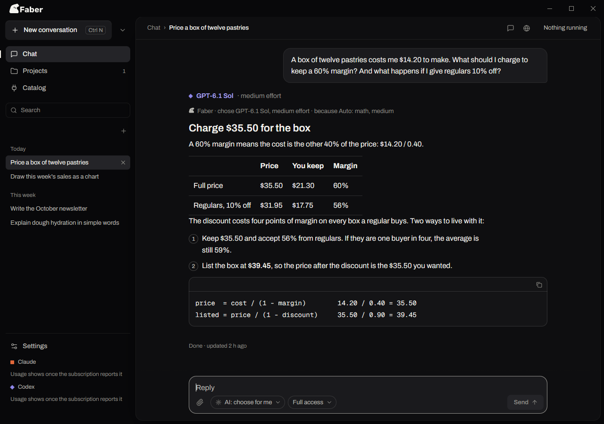

- **Auto.** The right model for each conversation and the right effort for each message, priced by the quota you
  have left. With Claude or ChatGPT connected, a small model reads your request alone and never sees the candidates.
  A fixed table of benchmark profiles (a few rows estimated) then picks, with Claude and ChatGPT models priced by the
  quota left right now. The first answer says which model was picked and why.
- **A conversation stays cheap to continue.** The makers charge much less for a message that continues a recent
  conversation (the prompt cache), and changing the model throws that discount away. So Auto keeps a conversation on
  one model unless you change it or quota runs out. Changing the effort keeps the discount, and a tool Faber closed
  after two idle minutes costs nothing to resume within the hour: both measured on the real tools.
- **Pacing.** For Claude and ChatGPT, Auto keeps you under about a seventh of your weekly quota per day, hands work
  to the other tool when one runs low, and never goes below what the task needs without telling you.
- **Out of quota is not the end.** With a second tool connected, the conversation goes on there, from the earlier
  messages or a summary of them. Faber never chooses paid credit for you: that takes two clicks, for one message.

These mechanisms do not add up to a cheaper total yet. Measured end to end on eight requests, Faber used at least
29% more tokens than Codex on its own and was slower than both tools.
[The numbers](#the-numbers-including-the-ones-we-lose) has the detail.

<details>
<summary>More: a small context, free waiting, the price on every answer</summary>

<br />

- **A small context.** From the Catalog, a session gets at most six skills and tool servers picked for the task; in
  Projects the other skills are a short index it can open. Faber's own standing instructions have a size budget that
  a test enforces. Faber's browser rereads a page as only what changed.
- **Waiting costs no tokens.** A timer follows the pull request a project conversation opened, and quota is read by
  local commands, not by a model (one tiny fallback request on Claude Code aside).
- **You see the price.** Claude and ChatGPT answers show their cost in API value (an estimate, never a bill). On
  Claude, the latest answer's cost says until when the next message is cheaper. Settings shows every quota window
  your AI tools report, with a mark for how much of its time has gone.

</details>

### 4. The project remembers, and keeps its promises

- **Memory in plain files.** Lasting choices are saved as plain text (Markdown) in the project's `.faber/` folder,
  readable in any editor and by any AI. Each one says who decided it. The AI's stay "AI, not reviewed" until you
  press Keep, and new Claude Code and Codex sessions in the project start already knowing the newest ones you kept.
- **"Never touch" is enforced.** Write and keep a rule of your own like "never touch `migrations/`" and Claude Code's
  file tools are denied that path in every mode; Codex keeps it read-only in its guarded modes. A prompt can be
  forgotten in a long session; a deny rule cannot. Not enforced yet: shell commands, Codex in Full access (which is
  how a new install starts) and Antigravity.
- **Standing goals.** "Every check passes", tied to one of your checks, off until you switch it on. Faber then looks
  every six hours. After two failures in a row it opens a conversation in a separate copy to fix it and leaves the
  result for you to approve. It starts no more than two fixes a day per project, none once the day's cost reaches
  US$2 at API prices.
- **Its own copy of your project per conversation.** In a Git repository each project conversation works on its own
  branch by default (a switch in Settings), so two conversations and your own folder do not overwrite each other.
  Faber never merges by itself.

<details>
<summary>More: pull requests followed for you, and Keep going</summary>

<br />

- **Pull requests the AI opens are followed for you** (through your GitHub CLI). If checks fail or the pull request
  conflicts, Faber wakes the conversation to fix it when quota allows. Nothing is spent while it is green.
- **Keep going.** Leave a job running: it stops by itself after 200 working turns or six failures in a row, and you
  get a "While you were away" summary.

</details>

### 5. A team that does not reread itself

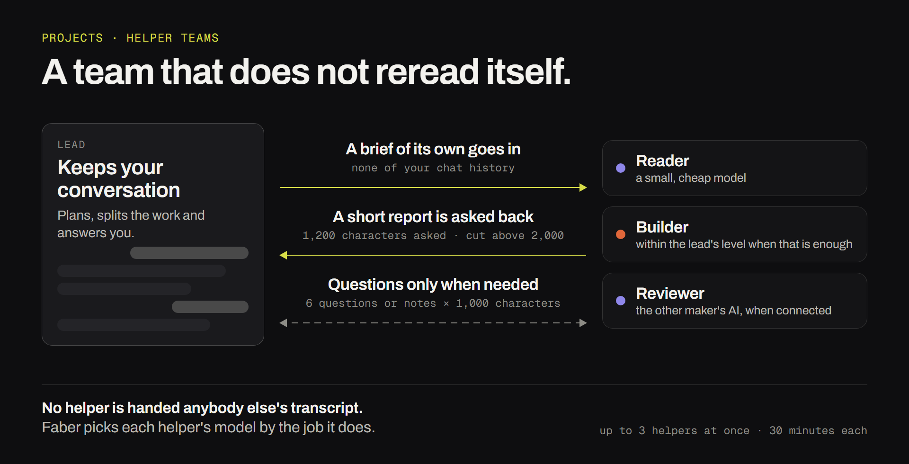

Extra agents cost extra tokens: [Claude Code's](https://code.claude.com/docs/en/agent-teams) and
[Codex's](https://learn.chatgpt.com/docs/agent-configuration/subagents) own docs say so. So in Projects, Faber bounds
what comes back and what the team says to each other. **A helper adds a brief and a report to the lead's
conversation, never a second copy of it.**

- **A helper never gets your chat history.** It starts from a brief of its own, written for its piece. (A reviewer of
  finished work is also given your request.)
- **It is asked for a short report**, about 1,200 characters. One over 2,000 is cut to an excerpt, and the full
  report goes to a file the lead opens only if it needs it.
- **They talk only when they need to.** At most six questions or notes of 1,000 characters per helper per reply,
  plus the lead's answers. A question nobody answers lapses with "decide yourself".
- **Faber picks each helper's model, not the lead.** A small model reads, a builder stays within the lead's level
  whenever that level can do the piece, and an adviser has to be stronger. With Claude Code and Codex both connected
  and quota on both, the first piece goes to the other maker, so the team is mixed.

<details>
<summary>More: the caps, and watching the team work</summary>

<br />

- **The size is capped.** Three helpers at a time per conversation, 30 minutes each, and a helper gets no helper
  tool of its own. Antigravity is not a helper yet.
- **You watch it happen.** Each helper is a card in the reply with its model, its state and the messages it
  exchanged. Write to one in the middle of its work, or stop them all.

</details>

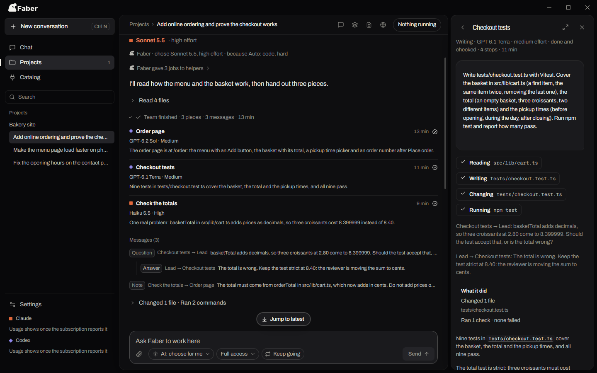

Is a team cheaper than one model doing everything? We have not measured that, so we do not claim it. Each helper is
a whole session and its tokens are spent; what the design bounds is how much of that flows back into your
conversation. [How teams work](docs/design/helper-team.md).

### 6. Light on your computer, and yours

- **About 110 MB with no AI tool running**, and Faber's own end-to-end test fails any build above 400 MB. A waiting
  AI tool is closed after two idle minutes and resumed on your next message.
- **Your login stays yours.** You sign in through each tool's own sign-in. Faber reads none of the tools' credential
  files; it only asks each tool whether you are signed in. Installing a tool from inside Faber downloads the official
  program and checks it against the maker's own checksum.
- **No third-party tool, skill or model is bundled.** The Catalog lists 118 skills, 4 tool servers and a plugin,
  each pinned to a version, checked and shown with its license, and downloads them from their original source when
  you install them.
- **Usage reporting (telemetry) is off by default**, and current builds have nowhere to send it.
- **Scriptable.** The `faber` command (in the Windows installer today) and `faber mcp` let a terminal, a script or
  another AI app list, read, search, send to and wait on conversations, over a local channel only your user can open.
- **Yours to shape.** Six looks, your own accent, fonts and density, and five languages: English, Brazilian
  Portuguese, Spanish, French and German.

## Where the ideas come from

Faber's behaviour is built from published guidance, read and cited in its own documentation and code. Their numbers
are theirs; Faber's own measurements are in the next section.

| In Faber | Where it comes from |
| :--- | :--- |
| Mixed teams: small workers, a stronger adviser, natural handoffs | Anthropic, [Which Claude model should you build with?, Mixing models](https://claude.dev/blog/which-claude-model-should-you-build-with/#mixing-models) |
| Raise effort before raising the model; step up only after a check | Anthropic's [cost and intelligence guidance](https://platform.claude.com/docs/en/about-claude/models/optimizing-for-cost-and-intelligence); OpenAI's [reasoning guide](https://developers.openai.com/api/docs/guides/reasoning) for raising effort only when evals show a benefit |
| Which kind of work goes to which kind of model | OpenAI's [models](https://learn.chatgpt.com/docs/models) page and Anthropic's launch material for its newest model |
| Auto's model profiles: quality, speed and cost per task | Artificial Analysis runs, republished by [Slopalytics](https://slopalytics.com/) |
| Cache rules: one model per conversation, effort is free to change | Faber's own probe of the real tools, in [cache and router, measured](docs/product/cache-router.md) |
| Review rounds and the evaluation of Faber's own instructions | The council skill in [tstack](https://github.com/t3dotgg/tstack) and [T3 Code](https://github.com/pingdotgg/t3code/tree/main/evals)'s evals |
| "Change only what was asked, and name the rest" | The OverEager-Bench study of unasked changes |
| Standing goals | Locke and Latham's goal-setting research and [Felix Rieseberg's essay](https://felixrieseberg.com/how-to-be-more-ambitious-a-tutorial-for-humans-with-models/) |
| Building and checking screens | WCAG 2.2, the WAI-ARIA practices, Fluent, Apple's interface guidelines, GOV.UK patterns, web.dev |
| The Roblox game pipeline | Roblox's own Creator documentation |

## The numbers, including the ones we lose

Every number here was measured on Faber itself, with its date and its method one click away. "Plain" means the same
tool used on its own, without Faber. Where a goal is not met yet, the table says so.

| What | Result | Read more |
| :--- | :--- | :--- |
| Memory with no AI tool running | 107 and 114 MB in CI (November 2026); the test fails above 400 MB | [release checklist](docs/dev/release-1.0.md#numbers) |
| Auto picking the right model | 81 of 88 picks right in October 2026, on 22 requests with the real router; half the routes under 2.8 s. The table has changed since | [models](docs/product/models.md) |
| Prompt cache across a change of effort, Claude Code | The whole earlier conversation still read from the cache (10,876 tokens read both times); Codex showed no loss beyond its usual variance | [cache and router](docs/product/cache-router.md) |
| Rereading a page in Faber's browser | 67 tokens, against 899 and 2,254 for the whole page again; the first read is larger | [benchmark](docs/dev/benchmark.md#browser-reads) |
| Tokens against the plain tools, eight requests, one run each (10 November) | **Not cheaper yet.** At least 29% more than plain Codex; 5% less than plain Claude Code on a count that leaves out Faber's routing and helper tokens, with five of eight requests costing more | [release checklist](docs/dev/release-1.0.md#real-use-the-owners-pc-real-subscriptions) |
| Time against the plain tools, same runs | **Slower.** 615 s against 397 s, and 255 s against 166 s | same page |
| Blind quality against plain Codex, an earlier run (6 November) | 3 wins, 1 loss, 4 ties, judged by one AI of the same maker | same page |

What Faber holds itself to, from the public [roadmap](docs/product/README.md#goals):

| Goal | Target |
| :--- | :--- |
| Quality in Projects | Win or tie 9 of 10 requests against the plain tools, by a blind judge from another maker plus proof that runs |
| Quality in Chat | Win or tie 8 of 10 against the same question asked in the makers' own chat apps, with zero invented citations |
| Quota and tokens | No more than 70% of the plain tool's cost for the same approved task |
| Precision | Half the corrections you have to ask for after "done" |
| Memory | Under 500 MB with no AI tool running |

Of these, the rows above measure two: memory is met and cost is not. This page will say so until it is. The
[benchmark](docs/dev/benchmark.md) runs with one command and uses a blind judge.

## A look inside

Every screenshot on this page is the real app in its default look, Dark Room, photographed in Faber's own test
build with a made-up bakery project and staged conversations.

<table>
  <tr>
    <td width="50%" valign="top">
      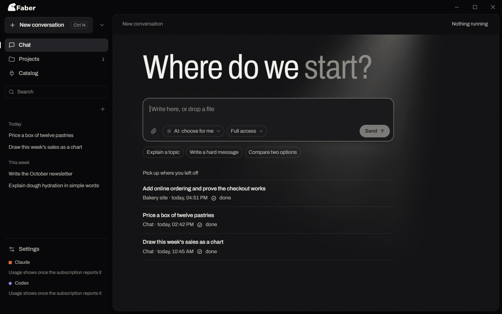
      <p><b>Chat.</b> Many conversations, groups with shared instructions and files, temporary chats, search, and
      branching from any answer.</p>
    </td>
    <td width="50%" valign="top">
      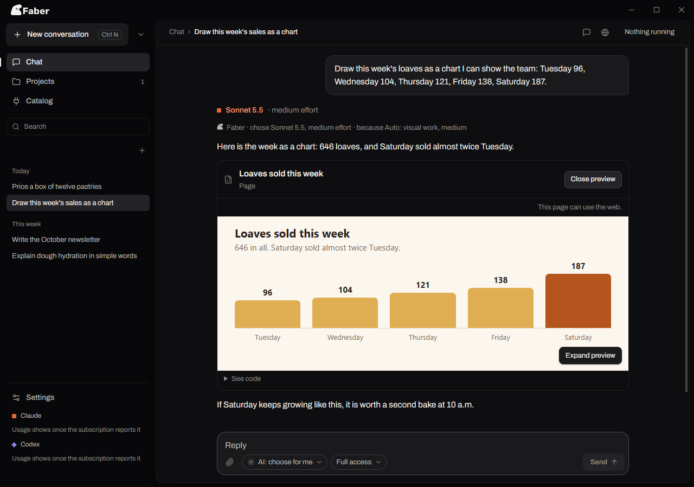
      <p><b>Answers you can use.</b> A chart, a table or a small page drawn inside the answer, with its code one
      click away.</p>
    </td>
  </tr>
  <tr>
    <td width="50%" valign="top">
      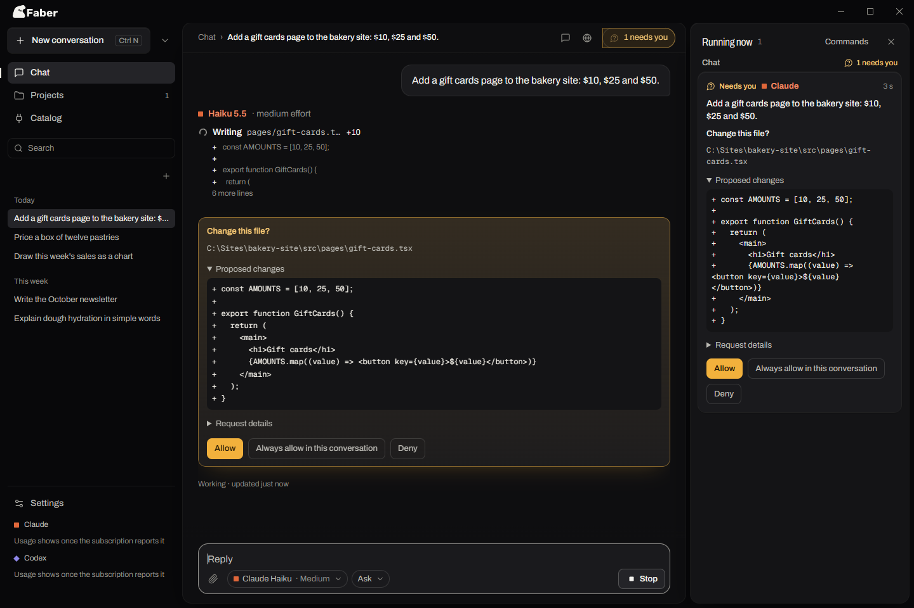
      <p><b>You decide how much it asks.</b> In Ask mode every change waits for your Allow or Deny, and the Running
      now column shows what needs you.</p>
    </td>
    <td width="50%" valign="top">
      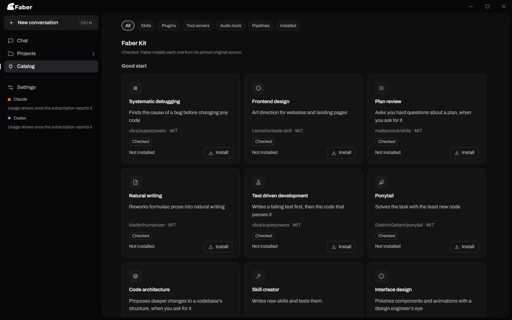
      <p><b>Catalog.</b> Skills and tool servers, each pinned to a version, checked and shown with its license,
      installed without touching your tools' own configuration.</p>
    </td>
  </tr>
</table>

### Make it yours

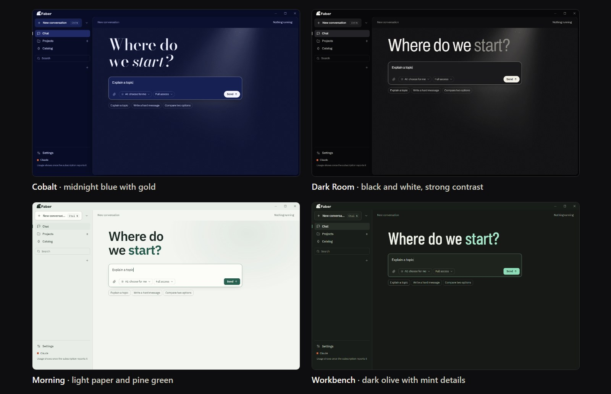

Dark Room is where you start. There are six looks in all (Dark Room, Workshop, Workbench, Morning, High contrast and
Cobalt), then your own accent, background, fonts, text size, density and motion, with a live preview before you
apply. Every look has to pass 26 contrast checks, and a look saves to a small file you can share.

## Install

Open [the latest version](https://github.com/startRED/faber/releases/latest), find **Assets** at the bottom (click it if
it is folded) and download the one file for your computer. `<version>` is the number shown on that page.

| Computer | File |
| :--- | :--- |
| Windows | `Faber_<version>_x64-setup.exe` |
| Mac with Apple silicon (M1 and later; Apple menu > About This Mac says "Chip") | `Faber-<version>-arm64.dmg` |
| Mac with an Intel processor (About This Mac says "Processor") | `Faber-<version>.dmg` |
| Linux | `Faber_<version>_x86_64.AppImage`, or `Faber_<version>_amd64.deb` on Debian and Ubuntu |

Skip the other files (`.zip`, `.app.tar.gz`, `latest.json`, `SHA256SUMS.txt` and the source code): they serve updates
and download checks.

- **Windows:** double-click the `.exe` and follow the installer. Faber is not code-signed yet, so Windows may show
  "Windows protected your PC": click **More info**, then **Run anyway**.
- **Mac:** open the `.dmg`, drag Faber into **Applications** and open it from there. Faber is not notarized by Apple
  yet, so the Mac may say it cannot check the app: close that message, open **System Settings > Privacy & Security**,
  click **Open Anyway** next to Faber, confirm, and open Faber again.
- **Linux:** mark the `.AppImage` as executable and open it, or install the `.deb` with your package manager.
- **First start:** Faber asks you to connect your subscriptions. One plan is enough: Claude Pro or Max, ChatGPT Plus
  or Pro for Codex, or Google AI Pro or Ultra for Antigravity (its free plan works too, with a smaller weekly limit).
  If a tool is missing, **Install** downloads the official program and checks the file is the original; then
  **Sign in** opens that tool's own sign-in.
- After that Faber checks for updates by itself.
- Every release carries build provenance. To check a download, run
  `gh attestation verify <file> --repo startRED/faber`.

> [!NOTE]
> Faber 1.0 is out; preview builds land most days and a stable one follows each week. Windows comes first: it is the
> only system whose full screen suite runs on every change. Linux and Intel Macs need testers:
> [tell us what happens on yours](https://github.com/startRED/faber/issues?q=is%3Aissue+is%3Aopen+label%3A%22help+wanted%22).

## What Faber does not do yet

- **Voice.** No dictation and no talking out loud with the AI.
- **Images.** No creating or editing images.
- **Schedules.** No repeating tasks or reminders; Keep going is the nearest thing.
- **Phone.** No app to follow or steer work from your phone.
- **Your other desktop apps.** The AI uses Faber's own browser, not your screen.
- **The browser outside Windows.** Faber's browser, the before and after pictures and Run my app are on Windows
  today.
- **Other makers.** No Copilot, Cursor, OpenCode, local models or API keys. This is on purpose.
- **Antigravity everywhere.** It answers in Chat and Projects in the Ask and Full access modes, and is not yet a
  helper or a reviewer.

The full list of gaps against the makers' own apps is in [parity](docs/product/parity.md), the plan is in the
[roadmap](docs/product/README.md), and what is in progress is on the
[board](https://github.com/startRED/faber/blob/board/BOARD.md).

## FAQ

**Do I need an API key?** No. Faber uses the plan you already have. One of them is enough.

**What does Faber cost?** Nothing. You pay only the plans you already pay for, and Faber never chooses paid credit
for you.

**Does Faber see my login?** No. You sign in through each tool's own sign-in, and Faber reads none of the tools'
credential files.

**Does Faber send my data anywhere?** Usage reporting is off by default. Conversations and projects are files on your
computer. The AI tools talk to their own services exactly as they do without Faber.

**Is a team cheaper than one model?** We have not measured it. Extra agents cost extra tokens in every tool. What
Faber bounds is the shape: a brief in, a short report asked back, a capped channel between them, and a smaller model
for the simpler pieces. [The numbers](#the-numbers-including-the-ones-we-lose) are the ones we have.

**Is it safe to let the AI change my files?** You choose. A new install starts in Full access, which does not ask
before each change. Ask shows every change for you to allow or deny. In a Git repository each project conversation
works on its own branch by default, and you can go back to before a message of yours with its saved files restored.

**Why not the terminal, or each maker's own app?** [Faber or something else?](#faber-or-something-else) says when
Faber is the better choice and when the other one is.

**Is it open source?** Yes. Faber is under the [MIT license](#license): anyone may use, change, share and sell it,
as long as the copyright notice stays with the copies.

**Is it finished?** No. Version 1.0 is out, [what it does not do yet](#what-faber-does-not-do-yet) is the list of
gaps, and the [roadmap](docs/product/README.md) is public.

## How it works

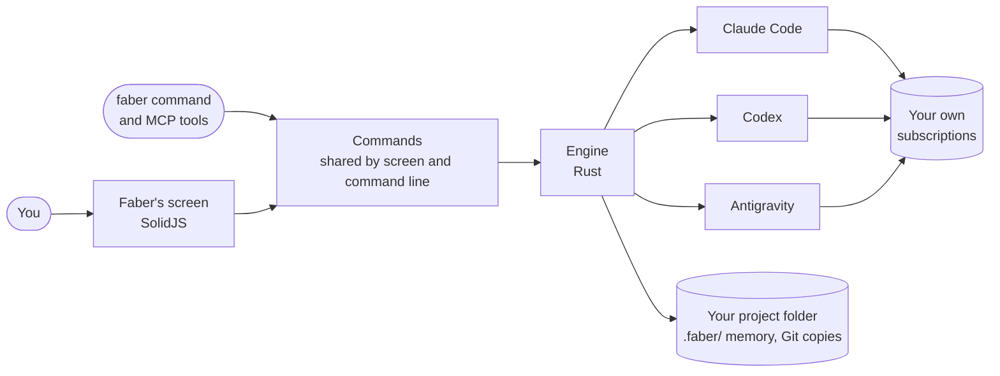

Faber starts the official command-line tools unmodified, never through a shell, and reads what they report. You sign in
through each tool's own flow. Conversations and projects are JSON files on your computer, and a project's memory lives
in its own `.faber/` folder. How the pieces fit, with the memory and processor budgets, is in
[architecture](docs/product/architecture.md). The [illustrated product demo](demos/faber/README.md) walks through a
project conversation from request to result; it is an illustration that runs no AI, and `npm run demo` opens it
locally.

## For AI agents reading this page

The facts, without the pitch:

| Question | Answer |
| :--- | :--- |
| What is it | A desktop app (Rust engine, SolidJS screen, Electron shell) that drives the official Claude Code, Codex and Antigravity command-line tools, unmodified, on the user's own subscriptions |
| What it is not | An API client, a model host or a fork of any of those tools. It holds no API key and reads none of the AI tools' credential files |
| Platforms | Windows x64 first; macOS on Apple silicon and Intel; Linux as AppImage and `.deb` |
| License | Open source, MIT |
| Install | One file from [the latest release](https://github.com/startRED/faber/releases/latest); see [Install](#install) |
| Where data lives | JSON files on the user's computer; project memory in the project's `.faber/` folder |
| Drive it from outside | The `faber` command (in the Windows installer today) and `faber mcp`: [command line](docs/product/cli.md) |

```bash
faber status                           # Faber's version and the conversations working or waiting
faber send "..." --to <conversation>   # send a message (no --to starts a new chat)
faber wait <conversation>              # block until its reply ends, then print it (300 s by default)
faber mcp                              # Faber's command table as MCP tools
```

To work on Faber itself, read these in this order:

| File | What it gives the agent |
| :--- | :--- |
| [AGENTS.md](AGENTS.md) | The rules every contributor follows, the stack and the proof commands (`CLAUDE.md` imports it) |
| [docs/README.md](docs/README.md) | Which living page answers which question, so the agent reads one page instead of a folder |
| [docs/product-map.md](docs/product-map.md) | What Faber has today, part by part, so new work extends it instead of adding a second way |
| [docs/decisions.md](docs/decisions.md) | The decisions in force, numbered, each with its author; search it for a word rather than reading it whole |

## Help Faber grow

Faber is built by one person with AI agents, and it is open source so that other people can build it too. Every bit
of outside help shows.

- **Two minutes:** star the repository so other people find it, and tell us what you expected and did not get in
  [Discussions](https://github.com/startRED/faber/discussions).
- **Ten minutes:** install Faber on Linux or an Intel Mac and report what happens, or read your own language in the
  app and correct it. Both are in the [help wanted](https://github.com/startRED/faber/issues?q=is%3Aissue+is%3Aopen+label%3A%22help+wanted%22) list.
- **An evening:** pick a [good first issue](https://github.com/startRED/faber/issues?q=is%3Aissue+is%3Aopen+label%3A%22good+first+issue%22).
  One bug or one improvement per pull request, with a test that fails without it.
- **Using an AI agent to contribute?** Welcome. Point it at [AGENTS.md](AGENTS.md) and read
  [the rules for AI-assisted changes](CONTRIBUTING.md#ai-assisted-contributions) first.

Start with [CONTRIBUTING.md](CONTRIBUTING.md), and see the [Code of Conduct](CODE_OF_CONDUCT.md). Report security
problems privately as described in [SECURITY.md](SECURITY.md).

## Build from source

<details>
<summary>Requirements, commands and the repository layout</summary>

<br />

You need Node 24 or newer, a stable Rust toolchain and the [Tauri prerequisites](https://tauri.app/start/prerequisites/)
for your system. On Windows that means the C++ build tools and WebView2. On Linux it means:

```bash
sudo apt-get install -y libwebkit2gtk-4.1-dev libayatana-appindicator3-dev librsvg2-dev libxdo-dev libssl-dev patchelf
```

Then:

```bash
npm ci
npm run dev
```

`npm run dev` opens the Tauri shell from source with live reload, and `npm run electron` opens the Electron shell the
installers ship. Before a change goes in, all of these exit 0:

```bash
npm run lint && npm run typecheck && npm run docs && npm run build && cargo fmt --all --check && npm run test:scripts && node scripts/cargo.mjs t --claims
```

`node scripts/cargo.mjs t` runs only the tests that depend on the files you changed; `node scripts/cargo.mjs t --all`
runs the full suite, including the hidden-window screen tests on Windows. Run it when the screen or the shell changes.

| Folder | What it holds |
| :--- | :--- |
| `engine/` and `engine-*/` | Rust: drives the tools, stores conversations and projects as JSON files; no windows |
| `host/` | The one command table every front end calls (window, command line, tests) |
| `sidecar/` | The host as a child process of the Electron shell, over newline-delimited JSON |
| `cli/` | The `faber` command line |
| `channel/` | The private local channel the command line uses to reach the running app |
| `electron/` | The Electron shell the installers ship |
| `src-tauri/` | The earlier Tauri shell, still opened by `npm run dev` |
| `ui/` | The screen: SolidJS and TypeScript, with every text in `ui/locales/` |
| `update/` | The self-updater |
| `winproc/` | The small amount of unsafe Windows process code |
| `installer/` | Electron installer packaging |
| `testkit/` | Faber's own Rust test runner and screen checks (`cargo t`) |
| `tests/` | Screen checks written in TypeScript |
| `scripts/` | Repository tooling: proofs, releases, docs checks |
| `bench/` | The benchmark against the plain tools |
| `docs/` | Living documentation, indexed in [docs/README.md](docs/README.md) |
| `demos/` | The illustrated product demo |

</details>

## License

Faber is open source under the [MIT License](LICENSE): anyone may use, modify, share and sell it, as long as the
copyright notice and the license text stay with every copy. See [NOTICE](NOTICE) and
[license and distribution](docs/product/distribution.md). What you create with Faber belongs to you.
